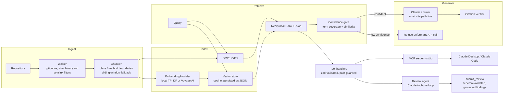

# Codebase Copilot

[](https://github.com/rkunameneni/codebase-copilot-mcp/actions/workflows/ci.yml)


**Make a source repository queryable by AI agents.** Codebase Copilot indexes a repository with
language-aware chunking and hybrid (BM25 + vector) retrieval, serves it to any MCP client
(Claude Desktop, Claude Code) as a set of narrow, path-guarded tools, and ships an agentic
code-review CLI that runs a Claude tool-use loop over those same tools and returns
schema-validated findings that point at real `file:line` locations.

Everything except the two commands that call Claude (`ask`, `review`) runs locally with no API
key, and the whole test suite runs offline.

| Package | What it does |
| --- | --- |
| [`packages/rag`](packages/rag) | Repository walker (honours `.gitignore`), Java/TS chunking on class and method boundaries, BM25, pluggable embeddings (local TF-IDF or Voyage AI), in-memory cosine store with a JSON index file, Reciprocal Rank Fusion, a confidence gate, and citation-grounded answers with Claude |
| [`packages/mcp-server`](packages/mcp-server) | MCP server on stdio (official `@modelcontextprotocol/sdk`): `search_code`, `get_file_snippet`, `explain_symbol`, `find_references`, `suggest_tests`, plus a `codebase://files` resource |
| [`packages/agent`](packages/agent) | `copilot` CLI: `index`, `search`, `ask`, and `review <path \| --diff>` - an AI code reviewer with retries, prompt caching, a max-iteration guard and token/cost logging |
| [`prompts/`](prompts) | Versioned prompt files with front matter; every output records the prompt id, version and hash |
| [`evals/`](evals) | Golden retrieval cases and an offline runner reporting recall@k, MRR and refusal accuracy |
| [`sample-repo/`](sample-repo) | A small Spring-style Java order service (plus one TS client) used by tests, evals and demos |

## Architecture



The MCP server and the review agent share one tool registry (`packages/mcp-server/src/tools.ts`):
the server exposes it over the protocol, the agent calls the same handlers in-process.

## Quickstart

Requires Node.js 20 or newer.

```bash
npm ci
npm run build
npm test                 # offline; no API key needed

# Index and search the bundled sample repository (no API key needed)
node packages/agent/dist/cli.js index  --root sample-repo
node packages/agent/dist/cli.js search "what happens when stock is insufficient" --root sample-repo --k 4
```

Actual output:

```text
src/main/java/com/example/orders/exception/InsufficientStockException.java:3-3  [class InsufficientStockException]  bm25#2 vec#1
src/main/java/com/example/orders/exception/InsufficientStockException.java:5-7  [constructor InsufficientStockException.InsufficientStockException]  bm25#1 vec#2
src/test/java/com/example/orders/service/InventoryServiceTest.java:19-23  [method InventoryServiceTest.reserveThrowsWhenStockIsInsufficient]  bm25#3 vec#4
src/main/java/com/example/orders/exception/InsufficientStockException.java:1-1  [block]  bm25#5 vec#3
confidence: ok; term coverage 67%
```

And for a question the code base cannot answer:

```text
$ node packages/agent/dist/cli.js search "how are payroll taxes withheld" --root sample-repo
confidence: LOW (only 0/3 query terms appear in the retrieved code (missing: payroll, tax, withheld)); term coverage 0%
```

To use Claude (`ask` and `review`), copy `.env.example` or export the key:

```bash
export ANTHROPIC_API_KEY=...        # never commit it; .env is git-ignored
node packages/agent/dist/cli.js ask "What happens to stock when an order is cancelled?" --root sample-repo
node packages/agent/dist/cli.js review src/main/java/com/example/orders/service/OrderService.java --root sample-repo
node packages/agent/dist/cli.js review --diff main --root .            # review your working tree against main
node packages/agent/dist/cli.js review --diff-file change.patch --root .
node packages/agent/dist/cli.js review src/Foo.java --root . --dry-run # print the exact request, no API call
```

| Variable | Default | Purpose |
| --- | --- | --- |
| `ANTHROPIC_API_KEY` | - | Required for `ask` and `review` only |
| `COPILOT_MODEL` | `claude-opus-5` | Claude model ID |
| `COPILOT_EFFORT` | `high` (review), `medium` (ask) | `low` ... `max`, or `none` to omit for models without effort support |
| `COPILOT_REFUSAL_FALLBACK` | `on` | Server-side refusal fallback (`fallbacks: "default"`); set `off` to disable |
| `COPILOT_EMBEDDINGS` | `tfidf` | `voyage` to use Voyage AI embeddings (needs `VOYAGE_API_KEY`, optional `VOYAGE_MODEL`, default `voyage-code-3`) |

## Use it from an MCP client

The server speaks MCP over stdio and indexes the repository at startup (it reuses
`<root>/.copilot-index/index.json` if present and still fresh; `--persist` writes it).
Logs go to stderr; stdout carries protocol messages only.

**Claude Code** - add it from the command line:

```bash
claude mcp add codebase-copilot -- node /absolute/path/to/codebase-copilot-mcp/packages/mcp-server/dist/cli.js --root /absolute/path/to/your/repo
```

or commit a project-scoped `.mcp.json` at the root of the repository you want to query:

```json
{
  "mcpServers": {
    "codebase-copilot": {
      "command": "node",
      "args": [
        "/absolute/path/to/codebase-copilot-mcp/packages/mcp-server/dist/cli.js",
        "--root",
        "."
      ]
    }
  }
}
```

**Claude Desktop** - `claude_desktop_config.json`:

```json
{
  "mcpServers": {
    "codebase-copilot": {
      "command": "node",
      "args": [
        "/absolute/path/to/codebase-copilot-mcp/packages/mcp-server/dist/cli.js",
        "--root",
        "/absolute/path/to/your/repo"
      ]
    }
  }
}
```

**Docker** - the image serves whatever is mounted at `/workspace` (read-only is fine):

```bash
docker build -t codebase-copilot-mcp .
docker run -i --rm -v "$PWD:/workspace:ro" codebase-copilot-mcp
```

```json
{
  "mcpServers": {
    "codebase-copilot": {
      "command": "docker",
      "args": ["run", "-i", "--rm", "-v", "/absolute/path/to/your/repo:/workspace:ro", "codebase-copilot-mcp"]
    }
  }
}
```

### Tools

| Tool | Input | Returns |
| --- | --- | --- |
| `search_code` | `query`, `k` (1-25), optional `language`, `pathPrefix`, `mode` (`hybrid`/`bm25`/`vector`) | Ranked chunks with `path:start-end`, symbol, per-leg ranks, code, and a confidence block |
| `get_file_snippet` | `path`, `startLine`, `endLine` | Numbered lines (max 400 per call) from an **indexed** file |
| `explain_symbol` | `symbol` (`Class`, `method` or `Class.method`), optional `path` | Signature, doc comment, code, enclosing class, members (for classes), reference count; suggestions when not found |
| `find_references` | `symbol`, `limit`, `includeDefinitions` | Whole-word occurrences as `path:line` with the matching line |
| `suggest_tests` | `path`, `method`, optional `framework` (`junit`/`jest`) | A JUnit 5 + Mockito or Jest skeleton derived from the real signature, collaborators and thrown exceptions |
| resource `codebase://files` | - | Every indexed file with language, size, line count and chunk count |

`suggest_tests` for `OrderService.cancelOrder` produces (abridged):

```java
@ExtendWith(MockitoExtension.class)
class OrderServiceCancelOrderTest {
    @Mock
    private OrderRepository orderRepository;
    // ... @Mock InventoryService, PaymentService, DiscountPolicy

    @InjectMocks
    private OrderService orderService;

    @Test
    void cancelOrder_returnsExpectedResult() {
        Long orderId = 1L;
        // Arrange: stub the collaborators this path uses: orderRepository.findById, orderRepository.save, inventoryService.release, paymentService.refundOrder

        Order result = orderService.cancelOrder(orderId);

        assertNotNull(result);
    }

    @Test
    void cancelOrder_throwsOrderNotFoundException() {
        Long orderId = 1L;
        // Arrange: set up the condition that makes cancelOrder throw OrderNotFoundException

        assertThrows(OrderNotFoundException.class, () -> orderService.cancelOrder(orderId));
    }
}
```

The skeleton compiles against the real signature and imports; the assertions are starting points
for a human to finish, not finished tests.

## AI-assisted code review

`copilot review` builds a review target (numbered file contents, or a unified diff annotated with
new-file line numbers), then runs a manual Claude tool-use loop:

1. The model reads the target and calls the codebase tools to gather context (callers, collaborators, related validation).
2. All tool calls from one turn run in parallel and go back in a single message; tool errors (bad input, blocked paths) are returned as `is_error` results so the model can correct itself.
3. The run ends when the model calls `submit_review` with input that passes the zod schema below. Invalid submissions are sent back with the validation errors.
4. Each finding is **grounded**: the file must be under review (or indexed) and the line must exist. Findings that fail are reported separately and never presented as results.

```ts
{
  summary: string,
  findings: Array<{
    severity: "critical" | "high" | "medium" | "low" | "info",
    file: string,          // repository-relative path
    line: number,          // 1-based, verified to exist
    issue: string,         // what is wrong and its concrete consequence
    suggestion: string,    // the change that fixes it
    category?: "correctness" | "security" | "data-integrity" | "error-handling"
             | "concurrency" | "performance" | "testing" | "maintainability"
  }>
}
```

Example of the text output format. This was rendered by the real `ReviewAgent` and
`formatOutcome` code, but **the model turn was scripted** (a fake client, as in
`agent.test.ts`), so token counts are zero and the findings were written by hand to show the
format, including a finding the grounding check discards:

```text
Review completed - 2 model calls, 2 tool calls, 0 in / 0 out tokens (cache read 0, cache write 0), est. $0.0000

Scripted example: cancelOrder has no state guard, so repeated or late cancellations refund and restock again.

[HIGH] src/main/java/com/example/orders/service/OrderService.java:69 (correctness)
  Issue:      cancelOrder never checks the current status, so cancelling a SHIPPED or already CANCELLED order refunds the payment again and returns stock that has left the warehouse.
  Suggestion: Allow cancellation only from PENDING or PAID and throw an IllegalStateException otherwise.

1 finding(s) discarded because their location could not be verified:
  - src/main/java/com/example/orders/service/OrderService.java:999: src/main/java/com/example/orders/service/OrderService.java has 89 lines; line 999 does not exist
```

`--format json` prints the full outcome (status, report, rejected findings, per-tool call log,
token usage, estimated cost and the prompt versions used). Structured JSON event logs
(`llm_call`, `llm_retry`, `tool_call`, `review_finished`) go to stderr.

The sample repository contains a few deliberate problems for the reviewer to find: string-built
SQL in `JdbcOrderSearchRepository`, `double` arithmetic for money in `DiscountPolicy`, and a
`cancelOrder` with no status check.

## Evaluation

`npm run build && npm run eval` runs the golden set in [`evals/golden.json`](evals/golden.json)
against the sample repository with the local TF-IDF embeddings: no network, fully deterministic.
Relevance is judged at file level, or at `file#symbol` level for cases about one method. Results
from the current code:

| Mode | Recall@1 | Recall@3 | Recall@5 | MRR |
| --- | --- | --- | --- | --- |
| bm25 | 63.6% | 81.8% | 86.4% | 0.748 |
| vector | 63.6% | 95.5% | 100.0% | 0.758 |
| hybrid | 63.6% | 86.4% | 100.0% | 0.745 |

Confidence gate (hybrid): 3/3 unanswerable questions refused, 0/11 answerable questions wrongly refused.

How to read this honestly:

- The set is small (11 answerable, 3 unanswerable questions over a 22-file corpus), so one case
  moves recall by about 9 points. It is a regression check, not a benchmark. CI fails if hybrid
  recall@5 drops below 90%.
- On this corpus the vector leg alone is slightly better than the fused result at recall@3. The
  local "vector" leg is TF-IDF with character trigrams, which is still lexical; fusion with BM25
  helps most when the two legs fail differently, which is the case a neural embedding model
  (`COPILOT_EMBEDDINGS=voyage`) is meant to create. That configuration has not been evaluated
  here because it needs an API key.
- The unanswerable questions (payroll taxes, Kafka topics, JWT key rotation) share no vocabulary
  with the corpus, which makes them easy for a term-coverage gate. Questions that reuse the
  corpus vocabulary but ask for something absent are harder and are not in this set.

## Design decisions

**Hybrid retrieval with Reciprocal Rank Fusion.** Code search mixes two kinds of queries: exact
identifiers (`JdbcOrderSearchRepository`, `OrderNotFoundException`) where BM25 is hard to beat,
and descriptive questions ("where is stock released when an order is cancelled") where
embeddings help. RRF merges the two rankings using ranks only, so BM25 scores and cosine
similarities never need to be normalized onto one scale. Each leg nominates `max(30, 3k)`
candidates before fusion.

**Chunking on code structure.** A small lexer masks strings, char literals, text blocks, template
literals and comments, so brace matching is not fooled by `"{"` or `// }`. Methods, constructors
and functions become their own chunks together with their Javadoc/JSDoc and annotations, and
carry `symbol`, `container` and `signature` metadata; a class chunk holds the declaration and
fields; imports and stray code become block chunks, so every non-trivial line is covered. Chunks
longer than 80 lines, and files in other languages, fall back to overlapping 40-line windows.
The indexed text for each chunk is prefixed with its path and symbol names, which is often the
strongest signal. Tokenization splits `camelCase`/`snake_case` while also keeping the whole
identifier.

**Grounding and refusal.** Refusal happens in layers:

1. *Before any tokens are spent:* retrieval reports term coverage (share of query terms present in
   the results) and the best cosine similarity; below the thresholds, `ask` refuses without
   calling Claude.
2. *In the prompt:* the model gets numbered sources and a single machine-checkable way out,
   `INSUFFICIENT_CONTEXT: ...`, which is surfaced as a refusal.
3. *After generation:* every `[path:start-end]` citation is checked against the retrieved
   sources' line ranges. An answer with no verifiable citation is marked `ungrounded`; invalid
   citations are listed, never silently kept.
4. *For reviews:* findings must name an existing file and line or they are discarded.

A `stop_reason` of `refusal` is handled explicitly, and the server-side refusal fallback
(`fallbacks: "default"`) is enabled by default and can be turned off.

**Cost control.**

- Refuse early: low-confidence questions never reach the API.
- Prompt caching: the review system prompt carries an explicit cache breakpoint (tools are
  rendered before the system prompt, so they are cached with it), and top-level automatic
  caching covers the growing conversation. The history is append-only (assistant turns are sent
  back exactly as received), so earlier turns stay cacheable. System prompts contain no
  per-request data for the same reason.
- Bounded loops: a max-iteration guard (default 8 model calls), a single nudge if the model
  answers in prose instead of submitting, and hard limits on tool output size (400 lines per
  snippet, 60 lines per search hit, 200 references).
- Effort is configurable per command (`high` for review, `medium` for Q&A).
- Every call logs input, output, cache-write and cache-read tokens with latency; cost is
  estimated per completed task with the published per-million-token prices (cache writes at
  1.25x, reads at 0.1x the input price). The estimate uses the requested model's price, so it is
  approximate if a fallback model served a turn.
- Retries are owned in one place: the SDK's built-in retries are disabled and `withRetry` retries
  429, 5xx (including 529) and connection errors with exponential backoff and jitter, honours
  `retry-after`, and never retries other 4xx errors.

**Security.** Model-supplied paths are untrusted input. `resolveIndexedFile` rejects absolute
paths, drive letters, NUL bytes and `..` escapes, re-checks containment after `realpath` (so a
symlink cannot point outside the root), only serves files that are in the index (so `.env`,
`.git/` and ignored files are unreachable even inside the root) and enforces a size cap. The
walker never follows symlinks and always ignores `.env*`, `.git/` and `node_modules/`. Tool inputs
are validated with zod before any handler runs, `git diff` is invoked with `execFile` and a
validated revision (no shell), and prompts tell the model that code and comments are data, not
instructions.

**Prompt engineering.** Prompts live in [`prompts/`](prompts) as versioned files
(`review.system.v1.md`, `review.task.v1.md`, `answer.system.v1.md`) with front matter. The loader
takes the highest version unless one is pinned, and the prompt id, version and a content hash are
recorded with every answer and review, so an output can be traced to the exact instructions that
produced it. See [`prompts/README.md`](prompts/README.md) for the conventions.

## Testing and CI

- 136 Jest tests (ts-jest) across the three packages, all offline: chunker and lexer edge cases,
  BM25, RRF, the vector store, TF-IDF and Voyage embeddings (mocked `fetch`), retry and backoff,
  the path guard (including symlink escapes, skipped on Windows without symlink privileges), every
  MCP tool handler called directly, the MCP server over an in-memory transport, and the review
  agent driven by a scripted fake Anthropic client (tool loop, parallel results, invalid
  submissions, refusal, `pause_turn`, `max_tokens`, 429/529 retries, the iteration guard,
  grounding).
- Coverage thresholds are enforced in `jest.config.js` (current: about 95% of lines).
- GitHub Actions runs lint (typecheck, ESLint, Prettier), tests with coverage, the build, the eval
  with a recall gate, a stdio smoke test that spawns the built server and calls it as an MCP
  client, CLI smoke tests (`search`, `review --dry-run`), and builds the Docker image and runs the
  same stdio smoke test against the container. Node 20 and 22.

## Limitations

- The chunker is a lexer plus heuristics, not a parser. It handles common Java and TypeScript
  well (see `chunker.test.ts`) but unusual formatting can produce a coarser chunk; oversized
  chunks still fall back to windows, so nothing is lost.
- `find_references` is lexical: it finds every whole-word occurrence, including same-named
  methods on unrelated classes and mentions in strings.
- The vector store is brute-force and in memory: fine for a repository of tens of thousands of
  chunks, not for a monorepo of millions. The `VectorStore` interface is where a real vector
  database would plug in.
- The live Claude paths (`ask`, `review`) are covered by tests with a scripted client; their
  output quality depends on the model and has not been measured here.

## Project layout

```text
packages/
  rag/          src/{ingest,chunking,retrieval,store,embeddings,llm,answer,eval}
  mcp-server/   src/{tools,security,symbols,testgen,server,cli}.ts
  agent/        src/review/{agent,targets,schema,format}.ts, src/cli.ts
prompts/        versioned prompt files
evals/          golden.json, run-evals.mjs
scripts/        mcp-smoke.mjs
sample-repo/    Java/TS fixture
docs/           ai-assisted-workflow.md
```

See [`CLAUDE.md`](CLAUDE.md) for contributor rules and [`docs/ai-assisted-workflow.md`](docs/ai-assisted-workflow.md)
for how AI tools were used to build this repository and how their output was checked.

## License

[MIT](LICENSE) (c) rkunameneni
